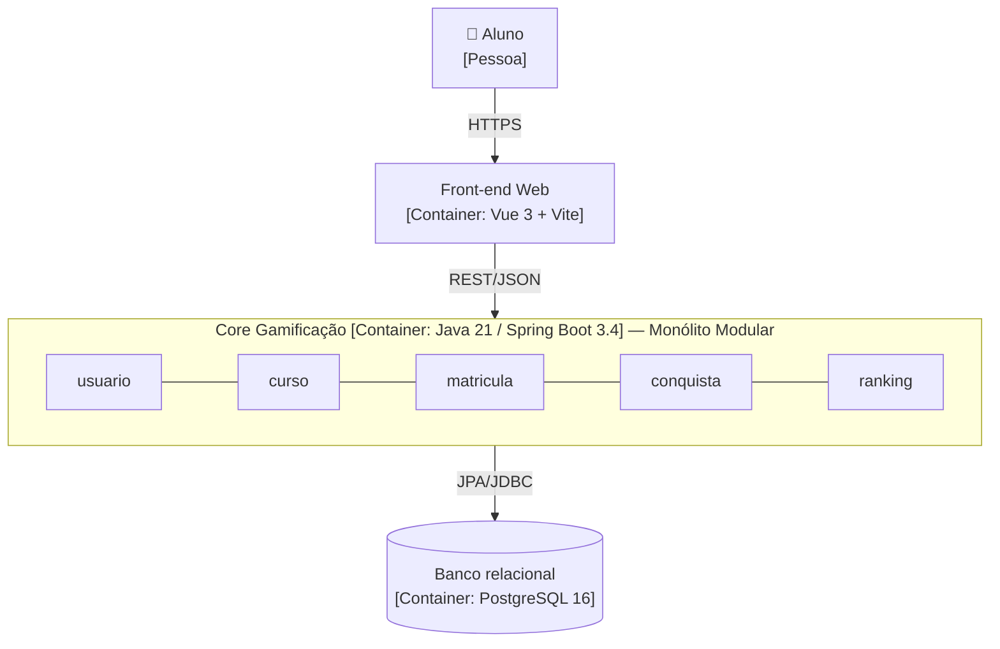

# Registro Arquitetural — B1 Architecture Lab

Registro vivo das decisões arquiteturais da plataforma **Educação Continuada Gamificada** (MVP da AC1). Cada desafio segue a mesma trilha:

**RF → RNF → ASR + RPC → alternativas/trade-offs → ADR → C4 → evidência**

| | |
|---|---|
| **Repositório** | https://github.com/Lohries/educacao-continuada-gamificada |
| **Equipe** | Mathues de Luzia Souza · Emanuel Ronaldo Gomes de Souza · Luis Henrique Telo Ladeira Mota |
| **Papel** | Tech Lead |
| **ADRs** | [`docs/adr/`](../adr/) |
| **Evidências** | [`docs/arquitetura/evidencias/`](evidencias/) |

## Case-base

A plataforma tem ranking, cursos, XP, níveis e badges. O Core da AC1 usa Java/Spring Boot e um banco relacional. O produto vai evoluir para:
- múltiplas instituições;
- recomendação inteligente e assistente com RAG/LLM;
- notificações e eventos de aprendizagem;
- integração com dispositivos IoT.

Tudo isso mantendo confiabilidade, testabilidade, observabilidade e evolução contínua.

### Requisitos funcionais do B1

| ID | Requisito | Desafios |
|---|---|---|
| RF01 | Ranking de alunos por XP | 1, 2, 6 |
| RF02 | Conquistas: XP, nível, badges e recompensas | 1, 2, 4 |
| RF03 | Recomendação inteligente de cursos | 3 |
| RF04 | Assistente educacional (RAG) | 3 |
| RF05 | Notificações | 4 |
| RF06 | Receber eventos IoT e encaminhá-los à plataforma | 5 |

### RPCs globais

| RPC | Origem |
|---|---|
| O Core continua em Java 21 / Spring Boot 3.4 | Legado da AC1 |
| ML e RAG são feitos em Python | Case (Desafio 3) |
| Banco relacional (PostgreSQL; H2 nos testes) | Legado da AC1 |
| Equipe de 6 desenvolvedores | Case (Desafio 1) |
| Os endpoints da AC1 continuam compatíveis com o front-end Vue | Legado da AC1 |
| Jenkins na esteira; Prometheus/Grafana no laboratório | Case (Desafio 6) |

---

## Matriz cumulativa de ASRs

| ASR | Atributo (FURPS+) | Desafio | O que muda na arquitetura | Decisão | Evidência |
|---|---|---|---|---|---|
| ASR-01 | Manutenibilidade (Supportability) | 1 | Estrutura: fronteiras por capacidade | [ADR-001](../adr/ADR-001-monolito-modular.md) | Dependências antes/depois; `ModularidadeTest` |
| ASR-02 | Escalabilidade do Ranking (Performance) | 1 | Estrutura/implantação: Ranking isolável para extração futura | [ADR-001](../adr/ADR-001-monolito-modular.md) | Ranking depende só da API de `usuario` |
| ASR-03 | Complexidade operacional (+ restrição de equipe) | 1 | Operação: um único deploy enquanto não houver evidência de escala | [ADR-001](../adr/ADR-001-monolito-modular.md) | Mesmo `docker compose` da AC1 |

---

## Desafio 1 — Drivers e evolução do Core

**Pergunta:** a carga de 100.000 usuários e o crescimento desigual do Ranking justificam distribuir o Core agora, ou uma modularização interna resolve com menor custo?

### RF / RNF

- **RFs:** RF01 Ranking e RF02 Conquistas, além da evolução de Cursos e Matrículas.
- **RNFs analisados:**
  - manutenibilidade (Supportability);
  - desempenho e escalabilidade (Performance);
  - testabilidade (Supportability);
  - complexidade operacional (restrição de operação, o "+" do FURPS+).

### ASR (máx. 3)

| RNF | ASR? | Por quê |
|---|---|---|
| Manutenibilidade | **Sim (ASR-01)** | As capacidades mudam em ritmos diferentes. Na AC1, mudar o Ranking mexia em `controller`, `service` e `dto`, e o `UsuarioService` misturava 3 capacidades (**estrutura**) |
| Escalabilidade | **Sim (ASR-02)** | O Ranking cresce mais que o resto e pode precisar de cache, réplica ou extração. Para isso, precisa de uma fronteira isolável (**estrutura/implantação**) |
| Complexidade operacional | **Sim (ASR-03)** | Serviços agora trariam rede, contratos e vários deploys para 6 pessoas (**operação**) |
| Desempenho | Não, por ora | Não há medição de latência que prove gargalo; vai ser medido no Desafio 6 |
| Testabilidade | Não como driver | Melhora com a modularização, mas não determina a decomposição |

### RPC

- Java/Spring Boot.
- 6 desenvolvedores.
- Banco relacional e legado da AC1.
- Endpoints compatíveis com o front-end.

### Alternativas e trade-offs

| | A — Monólito em Camadas | **B — Monólito Modular** | C — Ranking como serviço |
|---|---|---|---|
| Manutenibilidade (ASR-01) | Ruim: capacidades espalhadas | **Boa: 1 pacote por capacidade** | Boa |
| Escalabilidade (ASR-02) | Nenhuma fronteira | **Fronteira pronta, escala conjunta** | Escala independente |
| Operação (ASR-03) | 1 deploy | **1 deploy** | 2 deploys, rede, contrato e consistência de XP |
| Custo de mudança | Zero | Reorganizar pacotes | Alto |

### Decisão — [ADR-001](../adr/ADR-001-monolito-modular.md)

Adotar o **Monólito Modular**, com os módulos `usuario`, `curso`, `matricula`, `conquista`, `ranking` e `shared`:
- A API pública de cada módulo fica no pacote raiz dele.
- `internal/` e `web/` são privados.
- O **Spring Modulith** verifica as fronteiras a cada build.
- O Ranking fica como candidato a extração, com gatilho em métrica (Desafio 6).

### C4 — Container

A decisão é interna ao Core, então o Core continua sendo **um container**. O que muda é a organização interna, detalhada no C4 Component do Desafio 2.

### Evidência (mini-lab)

**Hipótese:** reorganizar por capacidade deixa as fronteiras explícitas sem mudar o comportamento.

**Antes e depois** ([relatório completo](evidencias/desafio-1/dependencias-antes-depois.md), gerado por [`analise_dependencias.py`](evidencias/desafio-1/analise_dependencias.py)):

| Métrica | Antes (camadas) | Depois (módulos) |
|---|---|---|
| Pacotes com código do Ranking | 3 (`controller`, `service`, `dto`) | **1** (`ranking`) |
| Pacotes com código de Conquista | 4 (`domain`, `entity`, `repository`, `service`) | **1** (`conquista`) |
| Imports entre pacotes de topo | 41 (11 arestas) | **16** (8 arestas) |
| Classes que misturam 3+ capacidades | 3 (`UsuarioService`, `MatriculaService`, `Matricula`) | 2 (`MatriculaService`, `Matricula`: orquestração esperada da matrícula) |

**Fronteiras verificadas:** o [`ModularidadeTest`](../../backend/src/test/java/br/edu/gamificacao/ModularidadeTest.java) roda `ApplicationModules.verify()`.
- **Falha simulada:** fiz o Ranking acessar `usuario.internal.UsuarioRepository`, e o build falhou ([log](evidencias/desafio-1/falha-simulada-fronteira.log)).
- **Comportamento preservado:** 25/25 testes passam, sendo 16 de domínio, 6 cenários BDD, 1 de contexto e 2 de modularidade ([log](evidencias/desafio-1/testes-apos-modularizacao.log)). `GET /api/usuarios/ranking` continua respondendo para o front-end.
- **Diagramas gerados pelo Spring Modulith** (PlantUML C4 Component): [`evidencias/desafio-1/spring-modulith/`](evidencias/desafio-1/spring-modulith/).

**Conclusão:** a modularização resolveu a manutenibilidade e criou a fronteira do Ranking sem nenhum custo operacional novo. A extração do Ranking **não** foi feita porque não há evidência de gargalo. O gatilho é a latência p95 e o throughput de `GET /api/ranking`, medidos no Desafio 6.
