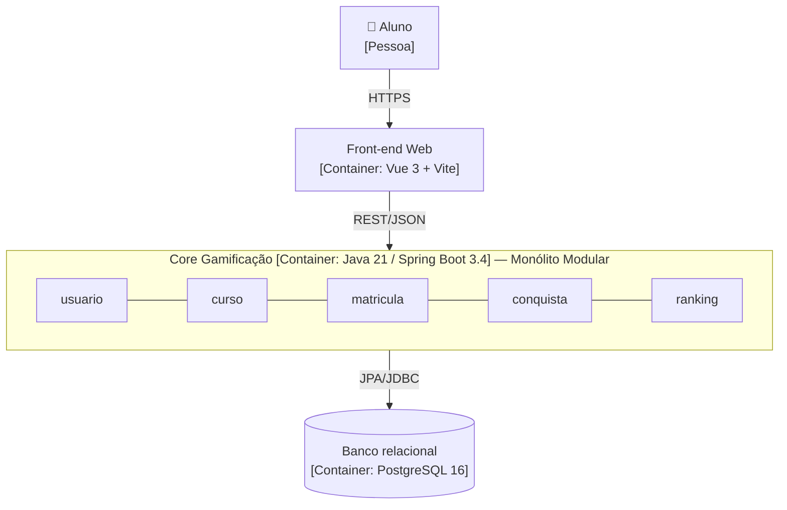
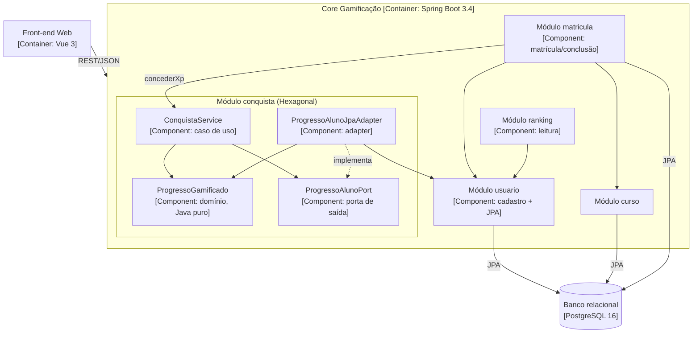
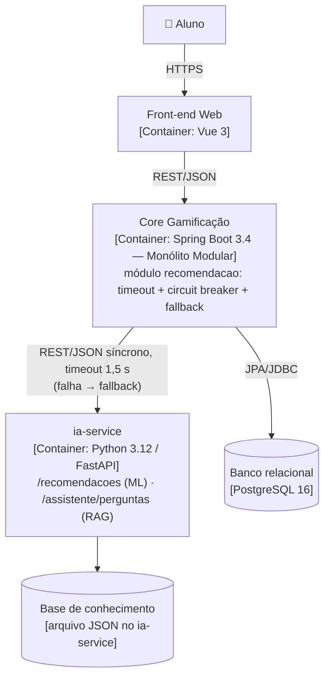
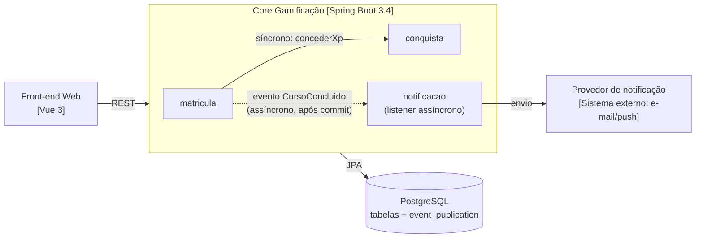
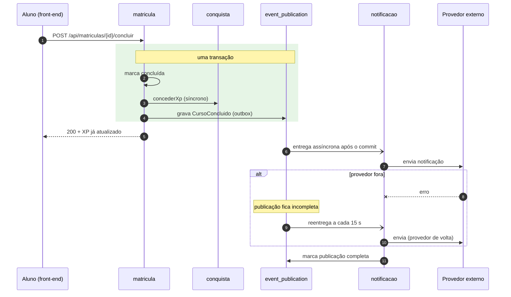
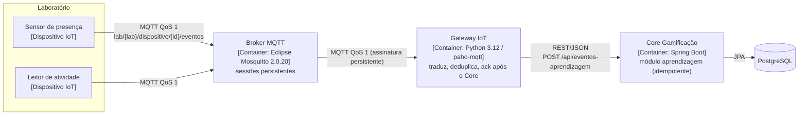

# Registro Arquitetural — B1 Architecture Lab

Registro vivo das decisões arquiteturais da plataforma **Educação Continuada Gamificada** (MVP da AC1). Cada desafio segue a mesma trilha:

**RF → RNF → ASR + RPC → alternativas/trade-offs → ADR → C4 → evidência**

| | |
|---|---|
| **Repositório** | https://github.com/Lohries/educacao-continuada-gamificada |
| **Equipe** | Mathues de Luzia Souza · Emanuel Ronaldo Gomes de Souza · Luis Henrique Telo Ladeira Mota |
| **Papel** | Tech Lead |
| **ADRs** | [`docs/adr/`](../adr/) |
| **Evidências** | [`docs/arquitetura/evidencias/`](evidencias/) |

## Case-base

A plataforma tem ranking, cursos, XP, níveis e badges. O Core da AC1 usa Java/Spring Boot e um banco relacional. O produto vai evoluir para:
- múltiplas instituições;
- recomendação inteligente e assistente com RAG/LLM;
- notificações e eventos de aprendizagem;
- integração com dispositivos IoT.

Tudo isso mantendo confiabilidade, testabilidade, observabilidade e evolução contínua.

### Requisitos funcionais do B1

| ID | Requisito | Desafios |
|---|---|---|
| RF01 | Ranking de alunos por XP | 1, 2, 6 |
| RF02 | Conquistas: XP, nível, badges e recompensas | 1, 2, 4 |
| RF03 | Recomendação inteligente de cursos | 3 |
| RF04 | Assistente educacional (RAG) | 3 |
| RF05 | Notificações | 4 |
| RF06 | Receber eventos IoT e encaminhá-los à plataforma | 5 |

### RPCs globais

| RPC | Origem |
|---|---|
| O Core continua em Java 21 / Spring Boot 3.4 | Legado da AC1 |
| ML e RAG são feitos em Python | Case (Desafio 3) |
| Banco relacional (PostgreSQL; H2 nos testes) | Legado da AC1 |
| Equipe de 6 desenvolvedores | Case (Desafio 1) |
| Os endpoints da AC1 continuam compatíveis com o front-end Vue | Legado da AC1 |
| Jenkins na esteira; Prometheus/Grafana no laboratório | Case (Desafio 6) |

---

## Matriz cumulativa de ASRs

| ASR | Atributo (FURPS+) | Desafio | O que muda na arquitetura | Decisão | Evidência |
|---|---|---|---|---|---|
| ASR-01 | Manutenibilidade (Supportability) | 1 | Estrutura: fronteiras por capacidade | [ADR-001](../adr/ADR-001-monolito-modular.md) | Dependências antes/depois; `ModularidadeTest` |
| ASR-02 | Escalabilidade do Ranking (Performance) | 1 | Estrutura/implantação: Ranking isolável para extração futura | [ADR-001](../adr/ADR-001-monolito-modular.md) | Ranking depende só da API de `usuario` |
| ASR-03 | Complexidade operacional (+ restrição de equipe) | 1 | Operação: um único deploy enquanto não houver evidência de escala | [ADR-001](../adr/ADR-001-monolito-modular.md) | Mesmo `docker compose` da AC1 |
| ASR-04 | Modificabilidade das regras de gamificação (Supportability) | 2 | Estrutura: dependências apontam para o domínio | [ADR-002](../adr/ADR-002-ports-and-adapters-na-conquista.md) | `HexagonalConquistaTest` (ArchUnit) |
| ASR-05 | Testabilidade do domínio (Supportability) | 2 | Estrutura: porta substituível por fake | [ADR-002](../adr/ADR-002-ports-and-adapters-na-conquista.md) | Contrato da porta com 2 adapters |
| ASR-06 | Tolerância a falhas da IA (Reliability) | 3 | Comunicação/operação: fronteira de processo, timeout, circuit breaker, fallback | [ADR-003](../adr/ADR-003-servico-python-de-ia.md) | `RecomendacaoDegradadaTest`; mini-lab com kill do Python |
| ASR-07 | Deploy independente da IA (Supportability) | 3 | Implantação: artefato e container próprios | [ADR-003](../adr/ADR-003-servico-python-de-ia.md) | `ia-service/Dockerfile`; serviço no `docker compose` |
| ASR-08 | Escalabilidade elástica da IA (Performance) | 3 | Implantação: réplicas da IA sem escalar o Core | [ADR-003](../adr/ADR-003-servico-python-de-ia.md) | Serviço sem estado (sem banco, sem sessão) |
| ASR-09 | Tolerância a falhas do fluxo de conclusão (Reliability) | 4 | Comunicação: consumidores assíncronos depois do commit | [ADR-004](../adr/ADR-004-eventos-de-conclusao.md) | `EventosConclusaoTest`; mini-lab com o provedor fora |
| ASR-10 | Recuperabilidade, sem perda de eventos (Reliability) | 4 | Dados/operação: evento persistido na transação (outbox) e reentregue | [ADR-004](../adr/ADR-004-eventos-de-conclusao.md) | Evento pendente → reprocessado em ~12 s |
| ASR-11 | Desacoplamento produtor/consumidores (Supportability) | 4 | Estrutura: contrato `CursoConcluido`; `matricula` não conhece `notificacao` | [ADR-004](../adr/ADR-004-eventos-de-conclusao.md) | `ModularidadeTest` (sem ciclo) |
| ASR-12 | Tolerância à conectividade intermitente (Reliability) | 5 | Comunicação/implantação: broker com sessão persistente, QoS 1, fila local, ack após o Core | [ADR-005](../adr/ADR-005-iot-mqtt-gateway.md) | Mini-lab: queda do dispositivo e do gateway sem perda |
| ASR-13 | Eficiência de comunicação (Performance) | 5 | Comunicação: MQTT com conexão mantida e payload compacto | [ADR-005](../adr/ADR-005-iot-mqtt-gateway.md) | 99 bytes por evento |
| ASR-14 | Interoperabilidade / Core desacoplado dos dispositivos (Supportability) | 5 | Estrutura: gateway traduz para o contrato do Core | [ADR-005](../adr/ADR-005-iot-mqtt-gateway.md) | `test_tradutor.py`; Core sem dependência de MQTT |

---

## Desafio 1 — Drivers e evolução do Core

**Pergunta:** a carga de 100.000 usuários e o crescimento desigual do Ranking justificam distribuir o Core agora, ou uma modularização interna resolve com menor custo?

### RF / RNF

- **RFs:** RF01 Ranking e RF02 Conquistas, além da evolução de Cursos e Matrículas.
- **RNFs analisados:**
  - manutenibilidade (Supportability);
  - desempenho e escalabilidade (Performance);
  - testabilidade (Supportability);
  - complexidade operacional (restrição de operação, o "+" do FURPS+).

### ASR (máx. 3)

| RNF | ASR? | Por quê |
|---|---|---|
| Manutenibilidade | **Sim (ASR-01)** | As capacidades mudam em ritmos diferentes. Na AC1, mudar o Ranking mexia em `controller`, `service` e `dto`, e o `UsuarioService` misturava 3 capacidades (**estrutura**) |
| Escalabilidade | **Sim (ASR-02)** | O Ranking cresce mais que o resto e pode precisar de cache, réplica ou extração. Para isso, precisa de uma fronteira isolável (**estrutura/implantação**) |
| Complexidade operacional | **Sim (ASR-03)** | Serviços agora trariam rede, contratos e vários deploys para 6 pessoas (**operação**) |
| Desempenho | Não, por ora | Não há medição de latência que prove gargalo; vai ser medido no Desafio 6 |
| Testabilidade | Não como driver | Melhora com a modularização, mas não determina a decomposição |

### RPC

- Java/Spring Boot.
- 6 desenvolvedores.
- Banco relacional e legado da AC1.
- Endpoints compatíveis com o front-end.

### Alternativas e trade-offs

| | A — Monólito em Camadas | **B — Monólito Modular** | C — Ranking como serviço |
|---|---|---|---|
| Manutenibilidade (ASR-01) | Ruim: capacidades espalhadas | **Boa: 1 pacote por capacidade** | Boa |
| Escalabilidade (ASR-02) | Nenhuma fronteira | **Fronteira pronta, escala conjunta** | Escala independente |
| Operação (ASR-03) | 1 deploy | **1 deploy** | 2 deploys, rede, contrato e consistência de XP |
| Custo de mudança | Zero | Reorganizar pacotes | Alto |

### Decisão — [ADR-001](../adr/ADR-001-monolito-modular.md)

Adotar o **Monólito Modular**, com os módulos `usuario`, `curso`, `matricula`, `conquista`, `ranking` e `shared`:
- A API pública de cada módulo fica no pacote raiz dele.
- `internal/` e `web/` são privados.
- O **Spring Modulith** verifica as fronteiras a cada build.
- O Ranking fica como candidato a extração, com gatilho em métrica (Desafio 6).

### C4 — Container

A decisão é interna ao Core, então o Core continua sendo **um container**. O que muda é a organização interna, detalhada no C4 Component do Desafio 2.



### Evidência (mini-lab)

**Hipótese:** reorganizar por capacidade deixa as fronteiras explícitas sem mudar o comportamento.

**Antes e depois** ([relatório completo](evidencias/desafio-1/dependencias-antes-depois.md), gerado por [`analise_dependencias.py`](evidencias/desafio-1/analise_dependencias.py)):

| Métrica | Antes (camadas) | Depois (módulos) |
|---|---|---|
| Pacotes com código do Ranking | 3 (`controller`, `service`, `dto`) | **1** (`ranking`) |
| Pacotes com código de Conquista | 4 (`domain`, `entity`, `repository`, `service`) | **1** (`conquista`) |
| Imports entre pacotes de topo | 41 (11 arestas) | **16** (8 arestas) |
| Classes que misturam 3+ capacidades | 3 (`UsuarioService`, `MatriculaService`, `Matricula`) | 2 (`MatriculaService`, `Matricula`: orquestração esperada da matrícula) |

**Fronteiras verificadas:** o [`ModularidadeTest`](../../backend/src/test/java/br/edu/gamificacao/ModularidadeTest.java) roda `ApplicationModules.verify()`.
- **Falha simulada:** fiz o Ranking acessar `usuario.internal.UsuarioRepository`, e o build falhou ([log](evidencias/desafio-1/falha-simulada-fronteira.log)).
- **Comportamento preservado:** 25/25 testes passam, sendo 16 de domínio, 6 cenários BDD, 1 de contexto e 2 de modularidade ([log](evidencias/desafio-1/testes-apos-modularizacao.log)). `GET /api/usuarios/ranking` continua respondendo para o front-end.
- **Diagramas gerados pelo Spring Modulith** (PlantUML C4 Component): [`evidencias/desafio-1/spring-modulith/`](evidencias/desafio-1/spring-modulith/).

**Conclusão:** a modularização resolveu a manutenibilidade e criou a fronteira do Ranking sem nenhum custo operacional novo. A extração do Ranking **não** foi feita porque não há evidência de gargalo. O gatilho é a latência p95 e o throughput de `GET /api/ranking`, medidos no Desafio 6.

---

## Desafio 2 — Organização interna do Core

**Pergunta:** qual dependência realmente precisa ser invertida para que as regras de gamificação mudem sem arrastar banco, framework e integrações?

### RF / RNF

- **RFs:** RF01 Ranking e RF02 Conquistas (regras de XP, nível e badges).
- **RNFs analisados:** manutenibilidade, testabilidade, modificabilidade e facilidade de evolução (todos de Supportability).

### ASR (máx. 3)

| RNF | ASR? | Por quê |
|---|---|---|
| Modificabilidade | **Sim (ASR-04)** | As regras mudam com frequência; precisam ficar num núcleo que não muda quando a persistência muda (**estrutura**: direção das dependências) |
| Testabilidade | **Sim (ASR-05)** | No D1, testar a regra exigia Spring + banco. Uma porta permite um fake (**estrutura**) |
| Manutenibilidade | **Sim (ASR-01, continua)** | O padrão fica dentro do módulo `conquista`, sem se espalhar pelo Core |
| Facilidade de evolução | Não separado | É consequência das três acima |

### RPC

- Spring Boot.
- Regras existentes reaproveitadas: `ProgressoGamificado` e os 16 testes da AC1 ficaram intactos.
- Proibido reescrever o produto inteiro.

### Alternativas e trade-offs

| | A — Serviço acoplado (D1) | **B — Ports & Adapters em `conquista`** | C — Clean/Hexagonal em todo o Core |
|---|---|---|---|
| Regra isolada da persistência | Não | **Sim** | Sim |
| Teste sem Spring | Não | **Sim** | Sim |
| Custo | Zero | **1 porta + 1 adapter** | Reescrever 5 módulos de CRUD sem regra volátil |
| Respeita "não reescrever tudo" | Sim | **Sim** | Não |

**DDD × Hexagonal × Clean × Onion:** não são concorrentes.
- O **DDD** dá as fronteiras e o modelo: `conquista` como *bounded context* e `ProgressoGamificado` como modelo de domínio.
- O **Hexagonal** dá a mecânica de inversão.
- Clean e Onion descrevem a mesma regra ("dependências apontam para dentro") em camadas concêntricas.

Combinamos DDD tático leve com Hexagonal, **só onde a regra é volátil**.

### Decisão — [ADR-002](../adr/ADR-002-ports-and-adapters-na-conquista.md)

A dependência invertida é **regra de gamificação → persistência**:
- `ConquistaService` (caso de uso) passa a depender só do domínio e de `ProgressoAlunoPort`.
- `ProgressoAlunoJpaAdapter` implementa a porta sobre a tabela `usuarios` da AC1.
- `ProgressoAlunoEmMemoria` implementa a porta nos testes.

### C4 — Component (Core)



### Evidência (mini-lab)

**Hipótese:** com a dependência invertida, a regra de domínio continua testada quando o adapter é trocado.

| Evidência | Resultado |
|---|---|
| ArchUnit (`HexagonalConquistaTest`) contra o código **do D1** | **Falha**: 8 dependências de `ConquistaService` para `usuario` ([log](evidencias/desafio-2/hexagonal-antes.log)) |
| ArchUnit contra o código **atual** | Passa: domínio e porta sem Spring/JPA; caso de uso sem adapter |
| Contrato `ProgressoAlunoPortContrato` × adapter **em memória** | 3/3 em 0,01 s |
| O **mesmo** contrato × adapter **JPA** (H2) | 3/3 em 15 s (sobe Spring + banco) |
| `ConquistaServiceTest`: caso de uso só com domínio + fake | 4/4 em 0,15 s, sem Spring |
| Testes de domínio da AC1 (`ProgressoGamificadoTest`) | 16/16, sem alteração |
| Suíte completa | **40/40** ([log](evidencias/desafio-2/testes-desafio-2.log)) |

**Conclusão:** só uma dependência precisava ser invertida, a de regra para persistência. O custo foi proporcional: 1 interface e 1 adapter, só em `conquista`. A troca de adapter foi comprovada pelo mesmo contrato passando nas duas implementações, e a regra passou a ser testável sem infraestrutura. A dívida registrada é o catálogo de badges duplicado entre o domínio e a tabela `badges`.

---

## Desafio 3 — Serviço Python e IA

**Pergunta:** onde fica a fronteira de ML e RAG/LLM, e qual comportamento degradado é aceitável quando a IA cai?

### RF / RNF

- **RFs:** RF03 Recomendação inteligente e RF04 Assistente educacional.
- **RNFs analisados:**
  - deploy independente (Supportability);
  - escalabilidade e desempenho (Performance);
  - tolerância a falhas (Reliability);
  - interoperabilidade e manutenibilidade (Supportability).

### ASR (máx. 3)

| RNF | ASR? | Por quê |
|---|---|---|
| Tolerância a falhas | **Sim (ASR-06)** | A IA pode cair e não pode bloquear o Core. Exige fronteira de processo, timeout, circuit breaker e fallback (**comunicação/operação**) |
| Deploy independente | **Sim (ASR-07)** | Os modelos mudam em ciclo próprio, então precisam de artefato e pipeline separados (**implantação**) |
| Escalabilidade | **Sim (ASR-08)** | A carga do assistente varia mais que a do Core. A IA escala réplicas sozinha (**implantação**) |
| Interoperabilidade | Não | REST/JSON resolve sem exigir nada especial |
| Desempenho | Não, por ora | O timeout de 1,5 s limita o impacto; vai ser medido no Desafio 6 |
| Manutenibilidade | Não | É consequência da separação |

### RPC

- O Core continua em Java/Spring Boot.
- ML e RAG são feitos em Python.
- A indisponibilidade da IA não pode bloquear o fluxo essencial.

### Alternativas e trade-offs

| | A — IA embutida no Core | B — Módulo acoplado | **C — Serviço Python independente** |
|---|---|---|---|
| RPC do Python | Viola | Cumpre | **Cumpre** |
| Falha da IA derruba o Core? | Sim | Sim (mesmo container) | **Não (fallback)** |
| Deploy e escala próprios | Não | Não | **Sim** |
| Custo | Baixo | Médio | **Rede, contrato e +1 container/pipeline** |

**ML e RAG:** ficam no mesmo serviço, por enquanto, em rotas independentes e sem estado compartilhado. Mesma linguagem, mesma equipe e mesma política de degradação. **Gatilho de separação:** o RAG adotar um LLM externo, com custo por chamada, latência de segundos ou GPU.

**Python sozinho justifica um serviço?** Não. O que justifica são os ASRs 06, 07 e 08. O Python é a RPC que descarta a alternativa A.

### Decisão — [ADR-003](../adr/ADR-003-servico-python-de-ia.md)

- **`ia-service`** (Python 3.12, FastAPI), sem estado e sem acesso ao banco do Core.
- No Core, o módulo `recomendacao` chama o serviço por REST/JSON com:
  - timeout de 1,5 s;
  - circuit breaker do Resilience4j (abre com 50% de falha em 3+ chamadas e tenta de novo em 15 s);
  - fallback local.

**Comportamento degradado:**
- A recomendação usa a regra local (menor XP primeiro) e marca `origem=fallback, degradado=true`.
- O assistente responde que está indisponível, sem inventar.

### C4 — Container (fronteira da IA)



O ia-service **não** acessa o banco: o Core envia o histórico e o catálogo em cada pedido.

### Evidência (mini-lab)

**Hipótese:** com a fronteira de processo e as proteções no cliente, uma falha da IA vira degradação, não erro, e não afeta o fluxo essencial.

**Testes automatizados** (stub HTTP no lugar do ia-service, [`RecomendacaoDegradadaTest`](../../backend/src/test/java/br/edu/gamificacao/recomendacao/RecomendacaoDegradadaTest.java)):

| Cenário | Resultado |
|---|---|
| IA no ar | `origem=ia`, modelo do serviço |
| IA responde 503 | `origem=fallback`, 3 cursos pela regra local, nenhuma exceção |
| IA lenta (1,5 s, timeout de 300 ms no teste) | Fallback em menos de 1,5 s |
| 6 chamadas com a IA falhando | Circuito **OPEN** depois de 3; as 3 seguintes **não chegam** ao serviço |
| Matrícula + conclusão com a IA fora | XP concedido normalmente |

Suíte completa: **45/45** no Java ([log](evidencias/desafio-3/testes-desafio-3.log)) e **8/8** no pytest do ia-service.

**Mini-lab real** ([script](evidencias/desafio-3/mini-lab.sh), [log](evidencias/desafio-3/mini-lab.log)): Core em Spring Boot (jar) consumindo o FastAPI (uvicorn).

| Passo | Observado |
|---|---|
| IA no ar | Recomendação e assistente com `origem=ia` (HTTP 200, 87 ms e 32 ms) |
| `kill` do processo Python | `localhost:8000` recusa conexão |
| Três recomendações + uma pergunta | Todas HTTP 200 com `origem=fallback`, em 9 a 53 ms |
| `/actuator/circuitbreakers` | `state: OPEN`, 2 falhas e 2 chamadas não permitidas |
| Matrícula e conclusão com a IA fora | HTTP 200; o aluno chegou a 250 XP, nível 3 |
| Python religado + 16 s | Recomendação volta a `origem=ia`, circuito `CLOSED` |

**Conclusão:** a fronteira de processo mais timeout, circuit breaker e fallback fez a queda da IA virar degradação controlada. Com o circuito aberto, o Core nem tenta chamar o serviço, então não acumula espera. A recuperação é automática. O custo aceito é a latência de rede e o catálogo enviado a cada pedido. Com catálogos grandes, o ia-service vai precisar de um índice próprio, alimentado por eventos.

---

## Desafio 4 — Comunicação e eventos

**Pergunta:** o que precisa ser síncrono na conclusão de um curso, o que pode ser eventual, e um broker resolve um problema real do fluxo?

### RF / RNF

- **RFs:** RF02 Conquistas e RF05 Notificações, mais o evento de conclusão de atividade.
- **RNFs analisados:**
  - tolerância a falhas, disponibilidade e recuperabilidade (Reliability);
  - latência (Performance);
  - consistência;
  - desacoplamento (Supportability).

### O que é imediato e o que é eventual

| Passo da conclusão | Imediato? | Motivo |
|---|---|---|
| Registrar a conclusão | **Sim** | Operação essencial |
| XP, nível e badges | **Sim** | O aluno vê o XP na resposta; consistência forte entre a conclusão e o XP |
| Notificação | Não, eventual | Provedor externo que falha; pode chegar segundos depois |
| Analytics e índice da IA (futuros) | Não, eventual | Não fazem parte da resposta |

### ASR (máx. 3)

| RNF | ASR? | Por quê |
|---|---|---|
| Tolerância a falhas | **Sim (ASR-09)** | Uma falha do consumidor não pode desfazer a conclusão (**comunicação**) |
| Recuperabilidade | **Sim (ASR-10)** | Com o consumidor fora, o evento não pode se perder (**dados/operação**) |
| Desacoplamento | **Sim (ASR-11)** | Novos consumidores não podem exigir mudança em `matricula` (**estrutura**) |
| Latência | Não | Melhora como consequência: a notificação sai da resposta |
| Disponibilidade | Não separado | Coberta pelo ASR-09 |
| Consistência | Não | Resolvida por passo: forte para o XP, eventual para o resto |

### RPC

- As operações essenciais concluem mesmo com um consumidor indisponível.
- Um broker tem custo operacional.
- Deploy único (ADR-001).

### Alternativas e trade-offs

| | A — Tudo REST síncrono | B — Evento em memória | **C — Evento persistido (outbox) + listener assíncrono** | D — RabbitMQ/Kafka |
|---|---|---|---|---|
| Falha da notificação afeta a conclusão? | **Sim: desfaz tudo** (teste) | Não | **Não** | Não |
| Evento se perde se o consumidor falhar? | — | **Sim** | **Não (reentrega)** | Não |
| Componente novo para operar | Nenhum | Nenhum | **Nenhum** (tabela no banco atual) | Broker |
| Consumidores fora do processo | — | Não | Não | Sim |

**RabbitMQ × Kafka, pelo problema do case:**
- O fluxo é comando/notificação com poucos consumidores e entrega pelo menos uma vez, o perfil do RabbitMQ.
- O Kafka se justificaria por um log retido, reprocessamento de histórico ou alto throughput, como analytics do *learning record*.

Hoje todos os consumidores estão no Core, então **nenhum dos dois resolve um problema real ainda**.

### Decisão — [ADR-004](../adr/ADR-004-eventos-de-conclusao.md)

- A conclusão e o XP continuam síncronos, na mesma transação.
- `matricula` publica `CursoConcluido`, que o **Event Publication Registry** do Spring Modulith grava na mesma transação (tabela `event_publication`).
- O módulo **`notificacao`** consome com `@ApplicationModuleListener`, de forma assíncrona e depois do commit.
- A falha fica registrada como publicação incompleta, que o `ReprocessadorDeEventos` reentrega a cada 15 s.
- O consumidor é idempotente (`matricula_id` único).
- **Broker adiado.** O gatilho é o primeiro consumidor fora do processo do Core. Nesse ponto, o Spring Modulith externaliza o mesmo evento para RabbitMQ ou Kafka, sem mudar o produtor.

### C4 — Container + sequência do fluxo crítico





### Evidência (mini-lab)

**Hipótese:** com a notificação assíncrona sobre um evento persistido, a falha do consumidor não afeta a conclusão, e nenhuma notificação se perde.

**Testes** ([`EventosConclusaoTest`](../../backend/src/test/java/br/edu/gamificacao/notificacao/EventosConclusaoTest.java)):

| Cenário | Resultado |
|---|---|
| Consumidor no ar | XP gravado no retorno de `concluir`; notificação entregue em seguida; 0 pendentes |
| Consumidor fora | Conclusão e XP gravados; **1 evento pendente**; nenhuma notificação. Com o consumidor de volta e reentrega: notificação entregue, 0 pendentes |
| **Contraste síncrono:** notificação chamada dentro da transação | A falha **desfaz** a conclusão, o XP e o próprio evento (rollback) |

Suíte completa: **48/48** ([log](evidencias/desafio-4/testes-desafio-4.log)).

**Mini-lab pela API real** ([script](evidencias/desafio-4/mini-lab.sh), [log](evidencias/desafio-4/mini-lab.log)):

| Passo | Observado |
|---|---|
| Concluir o curso 1 com o consumidor no ar | HTTP 200 em 128 ms, XP 100 já na resposta; notificação entregue; `pendentes=0` |
| Provedor de notificação derrubado (`/api/lab/notificacao?indisponivel=true`) | — |
| Concluir o curso 2 com o consumidor fora | **HTTP 200 em 23 ms**, XP 250; nenhuma notificação nova; **`pendentes=1`**; erro só no log do listener |
| Provedor religado | O reprocessamento automático entregou em **~12 s**; 2 notificações; `pendentes=0` |

**Conclusão:** separar o síncrono (conclusão + XP) do eventual (notificação) atendeu aos três ASRs. O outbox do Spring Modulith dá a garantia de entrega que um broker daria, para consumidores no mesmo processo, sem nenhum componente novo para operar. O broker fica reservado para quando aparecer um consumidor remoto.

---

## Desafio 5 — IoT e MQTT

**Pergunta:** como eventos de dispositivos limitados, com conexão instável, entram na plataforma sem acoplar o Core a cada dispositivo?

### RF / RNF

- **RF:** RF06 Receber eventos IoT (presença, início e conclusão de atividade) e encaminhá-los ao ecossistema.
- **RNFs analisados:**
  - interoperabilidade (Supportability);
  - eficiência de comunicação (Performance);
  - disponibilidade e tolerância à conectividade intermitente (Reliability);
  - escalabilidade;
  - segurança de integração.

### ASR (máx. 3)

| RNF | ASR? | Por quê |
|---|---|---|
| Conectividade intermitente | **Sim (ASR-12)** | Dispositivo e consumidor caem sem perder eventos. Exige broker com sessão persistente e QoS 1, e fila local no dispositivo (**comunicação/implantação**) |
| Eficiência de comunicação | **Sim (ASR-13)** | Pouca CPU e banda: protocolo leve e payload compacto (**comunicação**) |
| Interoperabilidade | **Sim (ASR-14)** | Dispositivos heterogêneos não chegam direto ao Core: um gateway traduz (**estrutura**) |
| Escalabilidade | Não | O broker absorve o fan-in; não muda a decisão |
| Disponibilidade | Não separado | Coberta pelo ASR-12 |
| Segurança de integração | Não muda a estrutura | Muda a configuração (TLS + ACL); fica como pendência para produção no ADR-005 |

### RPC

- Dispositivos com pouco poder computacional.
- Conectividade intermitente.
- Protocolo e broker adicionam componentes operacionais.

### Alternativas e trade-offs

| | A — REST direto ao Core | **B — MQTT + gateway** | C — MQTT + mensageria interna |
|---|---|---|---|
| Custo no dispositivo | HTTP/TLS por evento | **Conexão mantida, ~99 B por evento** | Igual a B |
| Core fora | Evento perdido ou retry no dispositivo | **Broker guarda; gateway só dá ack depois do Core** | Igual a B |
| Core conhece o dispositivo? | Sim | **Não (gateway traduz)** | Não |
| Componentes novos | Nenhum | **Broker + gateway** | Broker + gateway + segundo broker |
| Justificativa para C | — | — | Nenhum ASR: um só consumidor e entrega interna já coberta pelo ADR-004 |

**REST é suficiente?** Não para o dispositivo: não guarda nada no meio e pesa a cada evento.

**O que o MQTT resolve:**
- QoS 1 e sessão persistente;
- conexão mantida com keepalive;
- payload mínimo;
- tópicos para roteamento e ACL.

**Duplicidade e perda:**
- **Perda:** QoS 1 em cada salto, fila local no dispositivo, sessão persistente no broker e ack manual no gateway.
- **Duplicidade:** `eventId` gerado no dispositivo, cache LRU no gateway e unique no Core.

### Decisão — [ADR-005](../adr/ADR-005-iot-mqtt-gateway.md)

- **Broker:** Mosquitto 2.0.20.
- **Dispositivos:** QoS 1 e *store-and-forward*.
- **Gateway IoT** (Python): sessão persistente, ack manual depois do Core, tradução e deduplicação.
- **Core** (`aprendizagem`): `POST /api/eventos-aprendizagem`, idempotente pelo `eventId`.
- **Nenhum segundo broker.**

### C4 — Container + fluxo do evento



```mermaid
sequenceDiagram
    autonumber
    participant D as Dispositivo
    participant B as Mosquitto
    participant G as Gateway
    participant C as Core
    D->>B: PUBLISH QoS1 {id, d, t, a, ts}
    B-->>D: PUBACK
    note over D: sem conexão → fila local; reenvia ao reconectar
    B->>G: PUBLISH (sessão persistente guarda se o gateway estiver fora)
    G->>G: valida, traduz, checa cache de eventId
    G->>C: POST /api/eventos-aprendizagem
    C-->>G: 201 novo / 200 já registrado
    G-->>B: PUBACK manual (só depois do Core)
```

### Evidência (mini-lab)

**Hipótese:** com QoS 1, sessão persistente, fila local e ack depois do Core, nenhum evento se perde quando o dispositivo ou o gateway caem, e nenhum é registrado duas vezes.

**Mini-lab real** ([script](evidencias/desafio-5/mini-lab.sh), [log](evidencias/desafio-5/mini-lab.log)): Mosquitto 2.0.20 no Docker, Core (jar), gateway e simulador.

| Cenário | Observado |
|---|---|
| Rajada: 2 dispositivos × 4 eventos, **queda do sensor1** no meio e **2 duplicatas** | 8 gerados; 2 saíram da fila local depois da reconexão; 10 publicados e 10 confirmados pelo broker; **2 duplicatas descartadas no gateway**; **8 eventos no Core** |
| **Gateway parado**; dispositivos publicam 6 eventos | Broker confirmou os 6; o Core continua com 8 |
| Gateway religado (mesmo `client_id`, sessão persistente) | O broker entregou as 6 mensagens guardadas; **14 eventos únicos no Core** |
| Tamanho médio da mensagem | **99 bytes** por evento |
| Métricas do gateway (`:9101/metrics`, processo religado) | `recebidos=6`, `encaminhados=6`, `duplicados=0`, `falhas_core=0` |

**Testes:**
- `test_tradutor.py`: 10/10 ([log](evidencias/desafio-5/pytest-gateway.log)).
- `EventoAprendizagemTest`: 3/3; o mesmo `eventId` devolve 201 e depois 200, com um único registro.
- Suíte Java: **51/51** ([log](evidencias/desafio-5/testes-desafio-5.log)).

**Conclusão:** cada salto guarda o evento até o próximo confirmar: fila local, broker, ack manual e unique no Core. Por isso as quedas do dispositivo e do gateway não perderam nenhum evento, e as duplicatas foram barradas. O MQTT se justificou pela intermitência e pela eficiência, e não há ASR para um segundo broker. Para produção, falta só o endurecimento de segurança (TLS + ACL).
